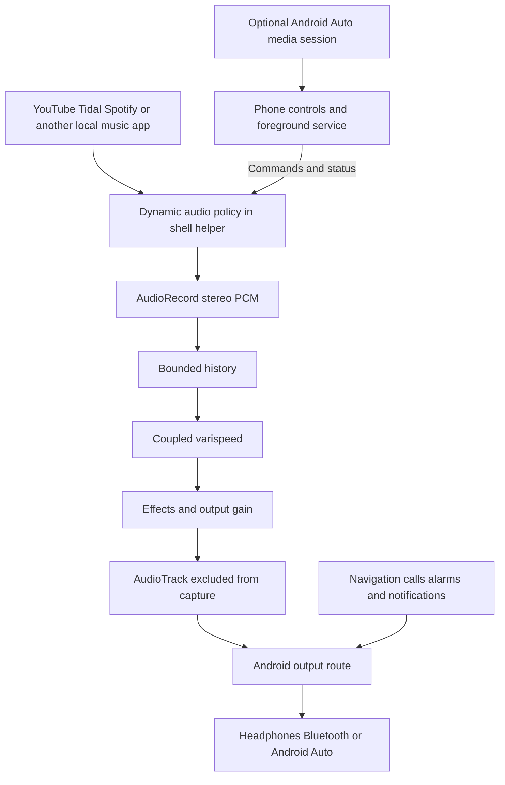

# TDSpeed Android architecture and manifesto

Design baseline: 20 October 2026. Status: implementation specification, before device validation.

Build a phone app that applies the TDSpeed listening effect to music played by other Android apps, without rooting the phone. Keep YouTube, Tidal, Spotify and other sources in their own apps. Put coupled pitch and speed, buffered listening, pause and re-centre under the listener's control. Make the processed output available to headphones, speakers, Bluetooth and Android Auto when the device route supports it.

The first target is the owner's Samsung Galaxy S24 Ultra. Its installed Android version, One UI build and car connection have not yet been recorded. The first release requires **Android 13 or later, ARM64 and Shizuku started through ADB**. Android 12 is outside the initial support range. Android 13 is a minimum candidate platform, not a promise that every manufacturer's build works.

This is the coding and packaging basis. It does not contain an APK or claim a successful Android device test. The first implementation must prove replacement audio routing on the S24 Ultra before a full effects rack or polished car interface is built.

## Manifesto

### Preserve the sound

Lower pitch must slow the music. Higher pitch must speed it up. Preserve the Windows engine's coupled behaviour and four-point Hermite interpolation. Do not substitute pitch-preserving time stretching or introduce a hidden rate correction to make accumulated delay disappear.

### Keep listening simple

The listener should choose music in the app they already use, start TDSpeed and hear the result. The main controls are pitch, pause, resume, re-centre, effects and stop. Technical setup belongs in onboarding and diagnostics. Everyday listening should not require choosing Android audio policies or managing a developer console.

### Make time and storage visible

Slowing a live source builds a backlog. Pausing the listening position can build more. Storage is finite. Show accumulated delay and available capacity, preserve unread music while capacity remains, and identify every deliberate discard. Re-centre must be a clear action that returns near the incoming audio without changing pitch.

### Respect the listener's choices

Resuming must not silently reset the buffer. Returning to original pitch must not silently jump forward. Reverb and effects must retain their settings. A source app changing tracks must not erase the music still waiting to be heard.

### Keep ordinary phone use intact

Navigation guidance, calls, alarms and notifications must stay outside the music history. Stop must release our audio route. Losing the helper or encountering an unsupported route must produce an honest status and a recoverable phone, not an apparently active effect that does nothing.

### Keep privileges narrow

Use Shizuku only for the routing and observation that need shell privileges. Do not require root, bootloader unlocking, firmware modification, a VPN, an accessibility service or music-service credentials. Process audio locally. Keep diagnostics free of recorded music by default.

### Earn compatibility claims

"Music from any app" is the product goal. Support is established per phone build, source app, playback mode and output route. A successful YouTube test does not establish Tidal compatibility, and a phone-speaker test does not establish Android Auto compatibility. Publish the matrix rather than a universal claim.

## Architecture decision

Use a normal Kotlin phone app for the interface, foreground lifetime, preferences and media controls. Bind a Shizuku UserService running as shell UID 2000. That helper owns a dynamic Android audio policy, AudioRecord, the native TDSpeed engine and AudioTrack. All PCM stays inside the helper process; Binder carries commands and status only.

The dynamic policy uses a pure loopback route to remove matching source playback from normal rendering. It exposes that audio to our processor and excludes the helper's output UID to prevent feedback. This depends on hidden Android interfaces and therefore needs a capability probe and tested platform adapters. It is not a public Android plug-in API. [Routing evidence](SOURCES.md#routing-and-privileges).

## Read and implement in this order

| File | Purpose |
|---|---|
| [ARCHITECTURE.md](ARCHITECTURE.md) | Process boundaries, routing, DSP, storage, controls and failure behaviour |
| [IMPLEMENTATION_PLAN.md](IMPLEMENTATION_PLAN.md) | Ordered milestones, deliverables and release gates |
| [INSTALLATION_AND_VALIDATION.md](INSTALLATION_AND_VALIDATION.md) | APK packaging, Samsung setup, car testing and recovery |
| [SOURCES.md](SOURCES.md) | Primary evidence, source baseline and limits of the design |
| [compatibility-template.json](compatibility-template.json) | Empty device test record; all results begin as not tested |

The distributed architecture ZIP also includes ARCHITECTURE_MANIFEST.json with document hashes. These hashes identify this specification package, independently of the future APK build manifest.

The minimum useful prototype is stereo dry forwarding with start, stop and fault recovery, followed by our actual varispeed engine with re-centre. Android Auto controls and storage-backed long listening follow after those foundations pass. The staged product must remain useful through the phone's controls even if a particular car cannot expose the companion controls.

The Windows release folders are reference inputs. Implementation belongs in a new Android project and a separately tested shared DSP extraction. This specification does not authorize silently replacing the Windows engine or changing its listening behaviour.
