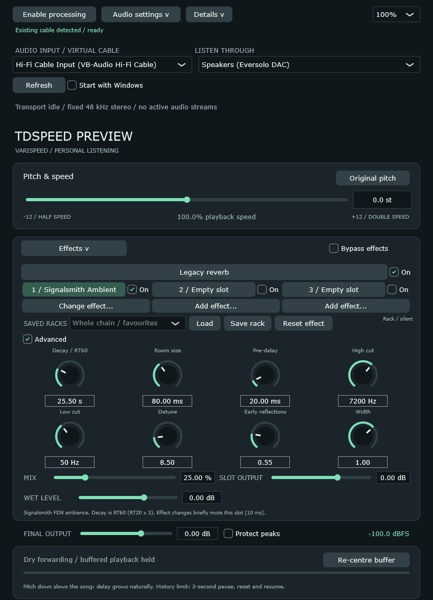
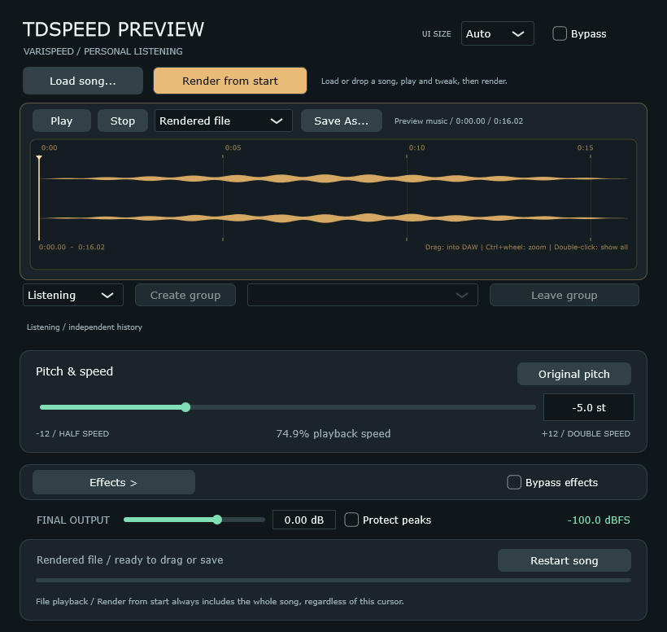

# Rockbox Pitch Plugin

A Windows listening app and VST3 inspired by Rockbox's pitch control: lower pitch slows the music down; higher pitch speeds it up. The song's length changes too.

I loved listening to slowed-down songs on my Sansa Clip Zip running Rockbox when I was younger. I couldn't find the same experience as a live effect on PC, so I made this.

**[Download 0.4.2-rc.1 (release candidate)](https://github.com/msikiric1993-coder/Rockbox-Pitch-Plugin/releases/tag/v0.4.2-rc.1)** | Windows 11 x64

## How it works

It uses the same kind of pitch shifting as Rockbox: changing playback speed changes pitch and tempo together. Incoming audio is buffered and read back more slowly or quickly, so lowering the pitch also makes the song longer.

The standalone app routes sound through a virtual audio cable, processes it and sends it to your speakers or headphones. That makes it a live effect for **YouTube, Spotify, Tidal** and other apps routed through the cable.

## The trade-off: growing delay

When you slow live audio, new audio arrives faster than it plays. Unplayed audio accumulates, so the delay keeps growing. If you change songs, you will still hear the queued audio first.

**Re-centre buffer brings playback back to the present moment** by discarding the queued audio. For example, after selecting another song, press it to hear the new song without waiting for the old backlog to play through. A small processing delay remains.

History uses up to **2 GiB of RAM**; at its limit, playback pauses for three seconds, resets the buffer and continues.

That delay is unavoidable when slowing a live source without discarding audio. For me, the sound is worth it.

## Effects

Reverb can really enhance slowed-down music. Open **Effects** for **three independent slots** with reverb, delay, chorus and more, then save combinations under **Saved racks**. Older settings can also retain a fourth, legacy reverb such as PSX. **Mix** is dry at 0% and fully processed at 100%.

## Install and listen

1. Download and run **TDSpeed-Setup-0.4.2-rc.1.exe**. It reuses a supported existing cable or installs the included standard VB-CABLE when needed. Restart Windows if requested.
2. Open **TDSpeedPreview**. In **Audio settings**, select the cable and your physical listening output, such as your DAC, audio interface or headphones.
3. Play some music, press **Enable processing** and move the pitch slider.

Already have a usable **Hi-Fi Cable or standard VB-CABLE**? Extract the **Portable ZIP** and run `TDSpeedPreview.exe`. No VSTHost or ASIO needed.

You may initially hear silence. With the cable and listening output selected, press **Enable processing at the top of the window**; audio should then start.

Closing hides the app to the tray; **Exit** restores normal Windows audio. The RC app and installer are currently unsigned; the bundled VB-CABLE driver is signed by its vendor. Do not confuse the driver signature with an application signature.

## VST3

Extract the **VST3 ZIP**, copy the complete `TDSpeedPreview.vst3` bundle into your DAW's VST3 folder and rescan. The plugin does **not** need a virtual cable. Keep the bundle intact, including its runtime DLLs. Its internal filename remains TDSpeedPreview for compatibility with existing projects.

To keep multiple processed tracks synchronized:

1. Select **Follow DAW** in each instance, with playback stopped.
2. Click **Create group** on one instance. It becomes the group leader. Use **Join group** on the others.
3. Set pitch on the leader and press Play. All members share pitch and bypass, while their effects and output levels remain independent.

Pitch changes during playback apply after **Stop/Play**. Grouped tracks share their buffered timing; they cannot stay aligned indefinitely with untreated tracks or different speeds.

## Render complete songs

Available in both the RC VST3 and standalone app. Rendering produces a complete new file; it does not depend on extending the original DAW clip.

**Drag in, tweak, render, drag out:**

1. Drag an audio clip/file from your DAW into the plugin waveform, or click **Load song...**. Loading does not render.
2. Press **Play** in **Song + effects**, then adjust pitch and effects.
3. Click **Render from start**. The complete changed-length song appears as a yellow waveform, including effect decay.
4. Drag that rendered waveform back into your DAW as a new clip. Mute the original and avoid applying the same processing twice.

The drag-in/render/drag-out workflow has been tested successfully by the project owner. The plugin also has its own **Save As** for a separate audio file; the DAW's Save As remains a separate project/export operation. Live processing does not resize the original DAW clip.

In the standalone app, open **Song render** for the same load, audition and render workflow. Its **Restart song** button rewinds the selected song and clears effect tails. Save as **AAC at a 320 kbps target (.m4a)** for compact listening files or **FLAC** for lossless PCM compression. Float/32-bit renders are converted to 24-bit PCM for FLAC, as shown in the panel. FLAC can still be substantially larger than an MP3.

AAC saving needs FFmpeg installed and available on PATH. If needed, run `winget install --id Gyan.FFmpeg -e`, then restart the app. FLAC works without FFmpeg.

## Exporting live VST processing

Live VST processing does not extend the DAW clip or export range, including in this RC. Exporting only the original song length can cut off music still waiting in the plugin's buffer.

**Recommended:** use the song renderer above and drag the complete result into the DAW. Alternatively, export a longer time selection from the song's beginning. Allow roughly **original duration / playback speed**, plus startup delay and reverb decay. For example, a four-minute song at 50% speed needs about eight minutes. Keep the plugin processing after the clip ends; add a silent extension if your DAW needs one. Hosts differ in how they handle reported tails; choose the export range explicitly.

## Source and credits

[Build instructions](docs/BUILD.md) | [Effect guide](docs/EFFECTS.md) | [Troubleshooting](docs/TROUBLESHOOTING.md)

[AGPL-3.0](LICENSE), with [third-party engine licences](Source/ThirdParty/VERSIONS.md). An independent Rockbox-inspired project, not an official release or bit-exact port.

The bundled standard **VB-CABLE** is donationware by [VB-Audio](https://vb-cable.com). [Donations and licences](https://vb-audio.com/Services/licensing.htm) support its developer.
